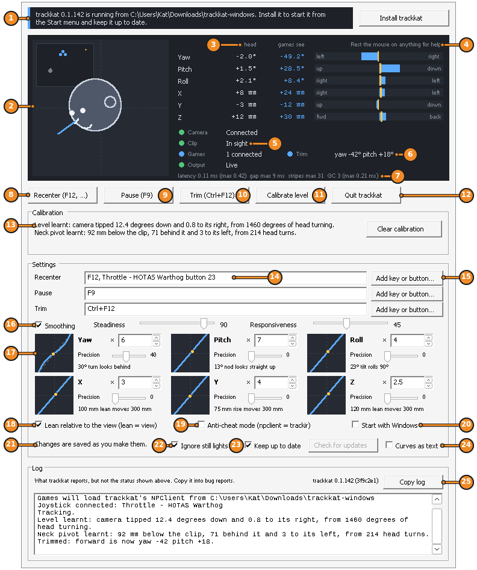
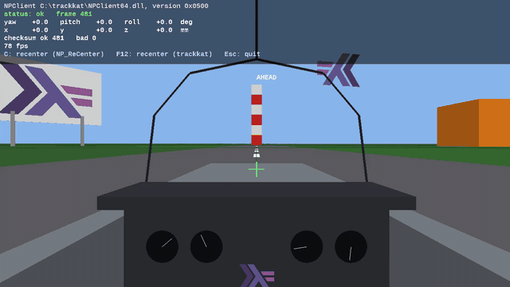

# trackkat 

Replacement software for the NaturalPoint TrackIR 5 (revision 3, USB id
`131D:0159`) on Windows. It tracks the TrackClip and gives games your head
pose through its own `NPClient` DLLs, like NaturalPoint's software, and
starts by itself when a game wants head tracking.

**Download** the latest build (no GitHub login needed):
<https://github.com/chreekat/trackkat/releases/download/dev/trackkat-windows.zip>

## One-time setup: switch the camera to WinUSB

The camera ships bound to NaturalPoint's driver, which only NaturalPoint's
software can use. trackkat talks to it through Microsoft's generic WinUSB
driver instead.

1. Quit the TrackIR software (including from the system tray).
2. Download [Zadig](https://zadig.akeo.ie/) and run it.
3. **Options → List All Devices.**
4. In the dropdown, pick the TrackIR. **Check that the USB ID boxes read
   `131D` `0159`** — if they show anything else you have the wrong device.
5. Set the target driver (right of the green arrow) to **WinUSB** and click
   **Replace Driver**.

To undo: Device Manager → the TrackIR → Update driver → Browse my computer →
Let me pick → choose NaturalPoint's driver. Reinstalling the TrackIR software
also restores it.

## First run

1. Unzip it and run `trackkat.exe`. Until builds are signed, Windows may
   say it protected your PC: click **More info**, then **Run anyway**.
2. Click **Install trackkat** at the top of its window. It installs for you
   alone, without admin, in the Start menu, and keeps itself up to date,
   so Windows doesn't ask again. (Or keep running it from where you
   unzipped it.) Games start trackkat themselves from then on.
3. Face the camera and press **F12** to recenter.
4. Start the game. The camera's second green light shows when a game is
   reading your head.

Uninstall it from Windows' Settings → Apps.

trackkat learns how your camera is tipped and where your neck pivots as you
look around; there is nothing to calibrate by hand.

## The window

Click the cat in the tray to open it. Rest the mouse on anything for a
tooltip saying what it does.

1. **Install trackkat**, while it runs from where you unzipped it; **Restart to update** once a new version is ready.
2. Your head as games see it; in the corner, what the camera sees: the clip's reflectors blue, other bright things amber, still lights ignored grey.
3. Each axis: your head, what games see after the curves, and a bar.
4. Rest the mouse on anything for help.
5. Camera, clip, games and output: green is good.
6. The trim: where Trim made the new forward.
7. Latency and other figures, for bug reports.
8. **Recenter**: where you face now becomes straight ahead; clears trim.
9. **Pause**: games see your head held still until you press it again.
10. **Trim**: where you look becomes forward, say at an MFD, until you recenter.
11. **Calibrate level**: after moving the camera, turn your head left and right for five seconds.
12. **Quit trackkat**. Closing the window instead keeps trackkat running in the tray.
13. What trackkat has learnt about your camera and neck; **Clear calibration** starts afresh.
14. Keys and buttons for each action, separated by commas; here a HOTAS button too.
15. **Add key or button…**: press a key, joystick button, or middle or side mouse button to add it.
16. Smoothing: steadiness against jitter, responsiveness against lag.
17. Response curves: a multiplier, a centre precision, and a plot with your head as a dot.
18. Lean relative to where the game's view looks, or to the screen.
19. Anti-cheat mode, for games such as Arma Reforger that refuse trackkat's NPClient.
20. **Start with Windows**, in the tray: the way to use anti-cheat mode without starting trackkat by hand.
21. Whether the last change was saved: settings are written to `trackkat.conf` as you change them, and apply at once.
22. **Ignore still lights**: a lamp or a fire behind you doesn't stop trackkat finding the clip; see [still lights](docs/details.md#still-lights).
23. **Keep up to date**: an installed trackkat fetches new versions in the background; **Check for updates** looks now.
24. **Curves as text**, for curves of any shape.
25. The log, and trackkat's version; **Copy log** for bug reports.

## Keys

- **F12** recenters, from anywhere, as does a game's own recenter binding.
- **F9** pauses.
- **Trim** has no key until you give it one.

Any of them can be other keys, joystick or HOTAS buttons, or the middle or
side mouse buttons.

## Settings

Change settings in the window, which saves them as you go, or edit
`trackkat.conf`, in `%APPDATA%\trackkat`, in any text editor; it explains
every setting, as [`trackkat.conf.example`](trackkat.conf.example) shows.
Either way they apply at once, while you play.

## When something doesn't work

- **No camera?** Check the WinUSB setup above, and that NaturalPoint's
  software isn't running. [`tirprobe`](docs/tirprobe.md) talks to the camera
  directly.
- **A game doesn't move?** `npclient.log`, in `%APPDATA%\trackkat`, records
  what each game asked for and got. `npgame` loads NPClient as a game does and prints
  the pose.
- **Anti-cheat blocks NPClient** (BattlEye, in Arma Reforger)? Set
  `npclient = trackir`; see [anti-cheat](docs/details.md#anti-cheat).
- **trackdemo**, in the zip, is a quicker test than a game: a cockpit that
  follows your head, using NPClient as a game does. **C** recenters through
  NPClient, **Esc** quits.

  

More on installing and updating, trim, calibration, the tray icon and when
trackkat quits by itself: [docs/details.md](docs/details.md).

## Building

Needs GHC 9.14, cabal and libusb-1.0 headers; dependencies are frozen in
`cabal.project.freeze`. `cabal build all --enable-tests && cabal test`. On
Windows, see `.github/workflows/build.yml` for pointing cabal at libusb.

## Credits

The USB protocol is ported from [linuxtrack](https://github.com/uglyDwarf/linuxtrack)
(MIT licence, © 2009 Tulthix, uglyDwarf), which reverse-engineered it.
