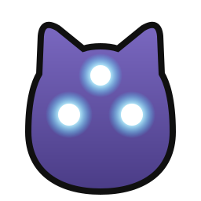
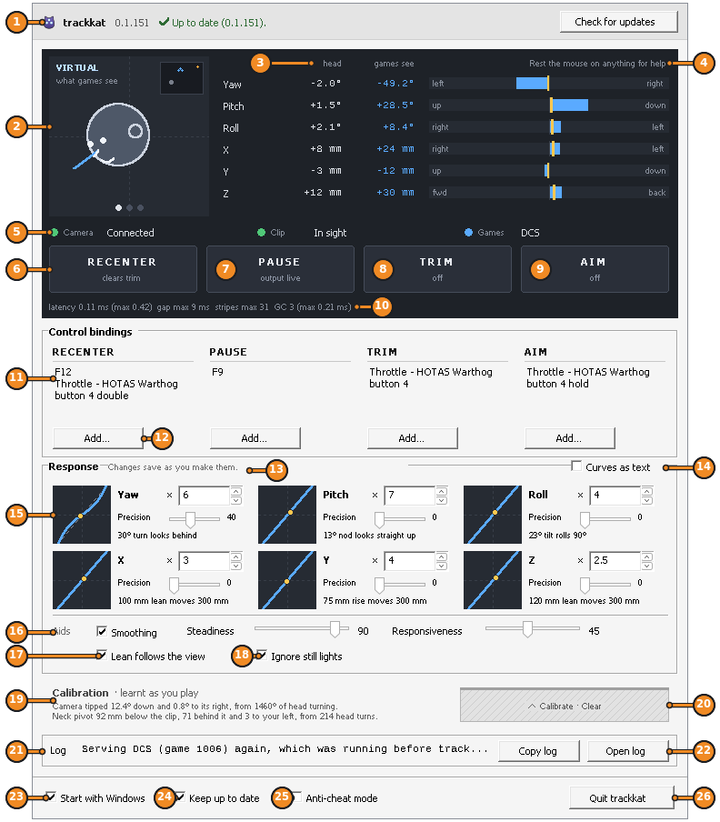
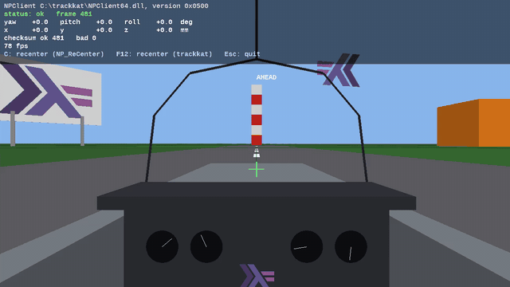

# trackkat 

Replacement software for the NaturalPoint TrackIR 5 (revision 3, USB id
`131D:0159`) on Windows. It tracks the TrackClip and gives games your head
pose through its own `NPClient` DLLs, like NaturalPoint's software, and
starts by itself when a game wants head tracking.

**Download** the latest build (no GitHub login needed):
<https://github.com/chreekat/trackkat/releases/download/dev/trackkat-windows.zip>

## One-time setup: switch the camera to WinUSB

The camera ships bound to NaturalPoint's driver, which only NaturalPoint's
software can use. trackkat talks to it through Microsoft's generic WinUSB
driver instead.

1. Quit the TrackIR software (including from the system tray).
2. Download [Zadig](https://zadig.akeo.ie/) and run it.
3. **Options → List All Devices.**
4. In the dropdown, pick the TrackIR. **Check that the USB ID boxes read
   `131D` `0159`** — if they show anything else you have the wrong device.
5. Set the target driver (right of the green arrow) to **WinUSB** and click
   **Replace Driver**.

To undo: Device Manager → the TrackIR → Update driver → Browse my computer →
Let me pick → choose NaturalPoint's driver. Reinstalling the TrackIR software
also restores it.

## First run

1. Unzip it and run `trackkat.exe`. Until builds are signed, Windows may
   say it protected your PC: click **More info**, then **Run anyway**.
2. Click **Install trackkat** at the top of its window. It installs for you
   alone, without admin, in the Start menu, and keeps itself up to date,
   so Windows doesn't ask again. (Or keep running it from where you
   unzipped it.) Games start trackkat themselves from then on.
3. Face the camera and press **F12** to recenter.
4. Start the game. The camera's second green light shows when a game is
   reading your head.

Uninstall it from Windows' Settings → Apps.

trackkat learns how your camera is tipped and where your neck pivots as you
look around; there is nothing to calibrate by hand.

## The window

Click the cat in the tray to open it. Rest the mouse on anything for a
tooltip saying what it does.

1. The version, and whether it is up to date; **Check for updates** looks now. Amber, with **Restart to update** once a new version is ready, or **Install trackkat** while it runs from where you unzipped it.
2. The head view; click it to switch between three, and it stays on the one you left it on. **Virtual**: your head as games see it, with what the camera sees in the corner. **Physical**: your own head as measured, dotted yellow, turning about your neck; once calibration is learnt, the clip on it, each reflector hollow while out of sight. **Camera**: the camera's whole picture, the clip's reflectors blue, other bright things amber, still lights ignored grey.
3. Each axis: your head, what games see after the curves, and a bar.
4. Rest the mouse on anything for help.
5. Camera, clip and games (by name): green is good.
6. **Recenter**: where you face now becomes straight ahead; clears trim and ends aiming.
7. **Pause**: games see your head held still until you press it again. Lit amber while paused.
8. **Trim**: the view now, where it looks and where it has moved to, becomes forward, until you recenter. Lit blue while trimmed, with where.
9. **Aim**: the view turns gently from where it is, to lay a gunsight on something by head, until you press it again. Lit blue while aiming.
10. Latency and other figures, for bug reports.
11. Keys and buttons for each switch above, one to a line; here a HOTAS button that trims when pressed, aims while held and recenters when pressed twice. Click a list to edit it.
12. **Add…**: press a key, joystick button, or middle or side mouse button to add it.
13. Whether the last change was saved: settings are written to `trackkat.conf` as you change them, and apply at once.
14. **Curves as text**, for curves of any shape.
15. Response curves: a multiplier, a centre precision, and a plot with your head as a dot.
16. Smoothing: steadiness against jitter, responsiveness against lag.
17. **Lean follows the view**, or the screen.
18. **Ignore still lights**: a lamp or a fire behind you doesn't stop trackkat finding the clip; see [still lights](docs/details.md#still-lights).
19. What trackkat has learnt about your camera and neck.
20. A cover: lift it for **Calibrate now** (after moving the camera, turn your head left and right for five seconds) and **Clear calibration** (start afresh).
21. The log's latest line; **Copy log** for bug reports.
22. **Open log**: the whole log, and trackkat's version, in a window of its own.
23. **Start with Windows**, in the tray: the way to use anti-cheat mode without starting trackkat by hand.
24. **Keep up to date**: an installed trackkat fetches new versions in the background.
25. **Anti-cheat mode**, for games such as Arma Reforger that refuse trackkat's NPClient.
26. **Quit trackkat**. Closing the window instead keeps trackkat running in the tray.

## Keys

- **F12** recenters, from anywhere, as does a game's own recenter binding.
- **F9** pauses.
- **Trim** and **Aim** have no key until you give them one.

Any of them can be other keys, joystick or HOTAS buttons, or the middle or
side mouse buttons. One button can do several things: write `hold` after it
for what it does when held down, and `double` for when it is pressed twice;
see [one button, several things](docs/details.md#one-button-several-things).

## Settings

Change settings in the window, which saves them as you go, or edit
`trackkat.conf`, in `%APPDATA%\trackkat`, in any text editor; it explains
every setting, as [`trackkat.conf.example`](trackkat.conf.example) shows.
Either way they apply at once, while you play.

## When something doesn't work

- **No camera?** Check the WinUSB setup above, and that NaturalPoint's
  software isn't running. [`tirprobe`](docs/tirprobe.md) talks to the camera
  directly.
- **Clip out of sight with its reflectors in view?** After a second the log
  says why, such as `The clip is out of sight, though 3 lights are in view:
  too close to the camera.`
- **Tracking goes wrong?** [Record it](docs/tirprobe.md#recording-a-problem)
  with tirprobe, so it can be replayed exactly.
- **A game doesn't move?** `npclient.log`, in `%APPDATA%\trackkat`, records
  what each game asked for and got. `npgame` loads NPClient as a game does and prints
  the pose.
- **Anti-cheat blocks NPClient** (BattlEye, in Arma Reforger)? Set
  `npclient = trackir`; see [anti-cheat](docs/details.md#anti-cheat).
- **trackdemo**, in the zip, is a quicker test than a game: a cockpit that
  follows your head, using NPClient as a game does. **C** recenters through
  NPClient, **Esc** quits.

  

More on installing and updating, trim, aim, calibration, the tray icon and when
trackkat quits by itself: [docs/details.md](docs/details.md).

## Building

Needs GHC 9.14, cabal and libusb-1.0 headers; dependencies are frozen in
`cabal.project.freeze`. `cabal build all --enable-tests && cabal test`. On
Windows, see `.github/workflows/build.yml` for pointing cabal at libusb.

The tests are in two groups: `unit`, which takes a second or two, and
`simulation`, of heads in front of the camera tracked for minutes, which
takes the rest. To run one alone, or the tests whose names have a word:

    TASTY_PATTERN='$2=="unit"' cabal test --test-show-details=direct
    TASTY_PATTERN=fire cabal test --test-show-details=direct

`TRACKKAT_SHOW=1 cabal test --test-show-details=direct` also shows the
figures each simulation came to, and `TRACKKAT_ACCEPT=1 cabal test` rewrites
`trackkat.conf.example` from the defaults. Properties are tried with new
random cases each run; one that fails says how to try its case again, as
`TASTY_QUICKCHECK_REPLAY='(SMGen 1 3,0)' cabal test`, and
`TASTY_QUICKCHECK_TESTS=100000` tries each with that many.

## Credits

The USB protocol is ported from [linuxtrack](https://github.com/uglyDwarf/linuxtrack)
(MIT licence, © 2009 Tulthix, uglyDwarf), which reverse-engineered it.
The table of games that need their head tracking data scrambled comes from
[OpenTrack](https://github.com/opentrack/opentrack)'s game list (ISC licence).
